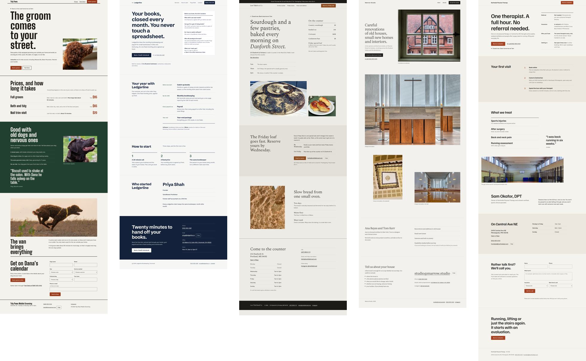
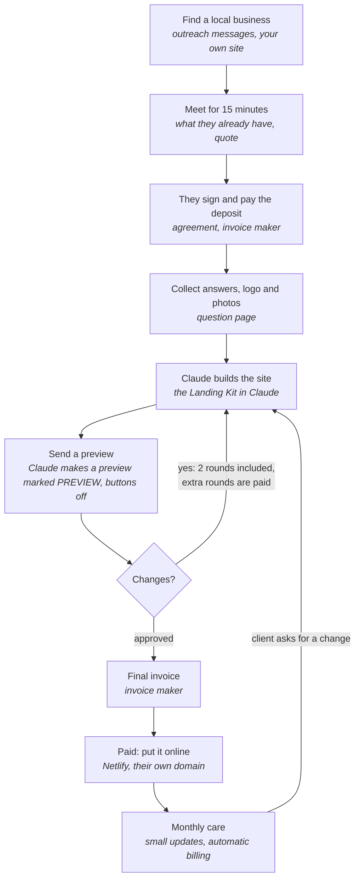

# Landing Kit

Run a small website business with Claude. No coding.

You find local businesses, collect their details, logo and photos, Claude designs a professional one-page site with you, and you put it online by dragging one file onto a website. Then you keep it updated for a monthly fee.

*Example sites for made-up businesses. Open them from `examples/demos` in the kit folder (their buttons are switched off). Photo credits are in [examples/CREDITS.md](examples/CREDITS.md).*

**Start here:**
1. In Claude, open **Customize**, then **Plugins**, then **Add**, then **Add marketplace**, and type `rode-0/landing-kit`. Add **Landing Kit**. (Turn on code execution in Claude's settings under Capabilities first.)
2. Open the setup page: https://rode-0.github.io/landing-kit/tools/setup/. It shows what to set up first and what to do next.
3. To start a client, open a new chat and say **"Use the landing kit to build a website for [business]"**.

---

## How the business works

Every step goes in your tracker, which shows each client's next step. The client only gets the working site after the final payment; until then they see previews.

## How the business runs

Follow these steps in order. Each one is a short page.

1. [Set up](plugin/skills/landing-kit/references/guide/01-set-up.md): in three levels, starting with just what you need for your first paid job (about an hour)
2. [Find clients](plugin/skills/landing-kit/references/guide/02-find-clients.md): who to approach and what to say
3. [Sell and sign](plugin/skills/landing-kit/references/guide/03-sell-and-sign.md): prices, the first meeting, the agreement, the deposit
4. [Collect the details](plugin/skills/landing-kit/references/guide/04-collect-details.md): answers, logo and photos
5. [Build and review](plugin/skills/landing-kit/references/guide/05-build-and-review.md): Version 1 and rounds of changes with the client
6. [Launch](plugin/skills/landing-kit/references/guide/06-launch.md): put it online and connect their domain
7. [Bill and track](plugin/skills/landing-kit/references/guide/07-bill-and-track.md): invoices, monthly billing, your dashboard
8. [Care and updates](plugin/skills/landing-kit/references/guide/08-care-and-updates.md): monthly changes and renewals
9. [Back up](plugin/skills/landing-kit/references/guide/09-back-up.md): keeping every client's work safe
10. [Market your business](plugin/skills/landing-kit/references/guide/10-market-your-business.md): your own site, a month of posts, and tracking what brings enquiries

**Not sure what to do next?** Ask Claude: "Use the landing kit: what do I do next?"

Who sets up, pays for and looks after each service: [who owns what](plugin/skills/landing-kit/references/guide/who-owns-what.md).

---

## What it costs, and what to charge

- **You pay:** a Claude plan (Pro is $20 a month; Max is $100 or $200 for much more use) and Netlify hosting for all your clients (start free; Personal is $9 a month).
- **The client pays you:** a one-time price for the site (including 2 rounds of changes), a set price for each extra round, and a monthly care price that covers hosting, the contact form and small updates.
- **The client pays directly:** only their domain name (usually $10 to $20 a year), bought in their name so they own it.
- **How many sites your Claude plan covers** isn't a fixed number, because Claude's limits reset every few hours and weekly. See the [time study](eval/README.md) for an estimate of what a typical site takes.
- **Hosting:** if your Netlify account runs out of monthly credits, every site you host pauses until the next month. Check usage monthly (see step 1, Level 2).
- **Times and earnings in this kit are estimates.** Track your own hours in the tracker, including finding clients and marketing.

Use the pricing page in `tools/pricing` to set your numbers.

*Prices as of November 2026. Check claude.com/pricing and netlify.com/pricing.*

---

## What's in the kit

| What | Where |
|---|---|
| The Landing Kit plugin: what Claude follows, the page checker, design notes, the business guide, email templates, the agreement and the tracker | Added once in Claude (Customize > Plugins). Lives in `plugin/` |
| The step-by-step business guide | [`plugin/skills/landing-kit/references/guide/`](plugin/skills/landing-kit/references/guide/) |
| Your tool pages: setup, question page, pricing, preview maker, invoice maker | https://rode-0.github.io/landing-kit/tools/ |
| Sample sites for made-up businesses (buttons switched off) | `examples/demos/` |
| The time study: how long a site takes and what it costs | `eval/` |
| Optional: an automatic posting script for someone technical | `extras/` |

You can also download everything as one ZIP from **Releases**, or upload the `landing-kit-plugin` ZIP from Releases in Claude (Customize > Plugins > Add > Upload plugin) instead of adding the marketplace.

## If something goes wrong

- **Claude doesn't seem to use the kit.** Check the Landing Kit is turned on under Customize > Plugins, and start your message with "Use the landing kit".
- **"Copy my answers" doesn't work for the client.** They probably opened the link inside Instagram or Facebook. Ask them to open it in Safari or Chrome.
- **The contact form doesn't send.** Check the Web3Forms key is the real one from the email. Forms only send from the live Netlify site, not the Claude preview.
- **Photos or the logo don't show.** Tell Claude "the photos aren't showing" and it will fix it.
- **Something looks wrong on a phone.** Attach a screenshot in the chat and say what's wrong.
- **All my clients' sites say "Site not available".** Your Netlify credits ran out. Upgrade your plan or turn on auto recharge in Netlify's billing settings, or wait for next month.
- **Claude won't make a share link for the client's site.** That's expected: Claude doesn't publish public pages with a real business's name. Send a preview package from the preview maker instead (step 5).
- **I can't get the site online.** Launch needs a computer and you signed in to Netlify. See the checklist and "If you get stuck" in [step 6](plugin/skills/landing-kit/references/guide/06-launch.md).
- **A pasted tracker line landed in one cell.** Copy it from Claude's box (it uses tabs), click the first empty cell in column A, and paste again.
